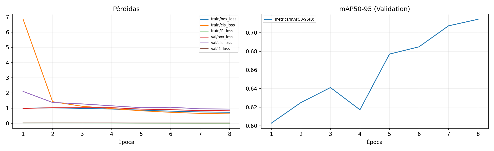
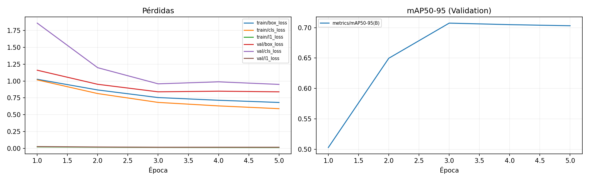
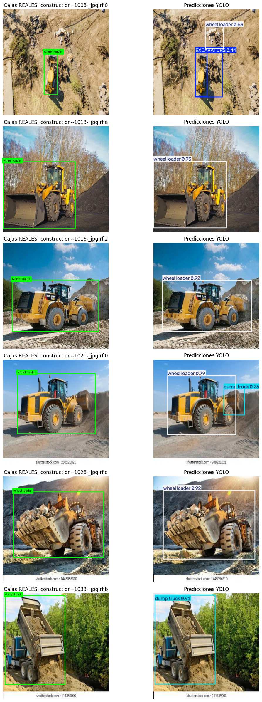
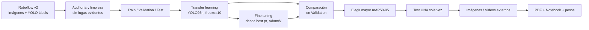

<div align="center">

# 🏗️ YOLO Maquinaria UBO

### Detección y localización de maquinaria de construcción · YOLO26n

**Auditoría de datos → transfer learning → fine tuning → Validation → Test → demostraciones externas.**

**Universidad Bernardo O'Higgins · Machine Learning · Evaluación 03 · 2026**

**Mathis Marsault · Julien Martinat · Louis Maillet**

[](https://www.python.org/)
[](https://docs.ultralytics.com/models/yolo26/)
[](https://colab.research.google.com/)
[](https://creativecommons.org/licenses/by/4.0/)
[](https://github.com/MamatorHack/YOLO-Maquinaria-UBO/actions/workflows/validate.yml)

**Detector entrenado por el equipo y evaluado mediante un protocolo reproducible, sin utilizar Test para seleccionar el modelo.**

  

**Ir a:** [Resultados](#resultados) · [Dataset](#dataset) · [Entrenamiento](#entrenamiento) · [Vídeos](#videos) · [Reproducción](#reproduccion) · [Checklist](#checklist)

[📓 Notebook ejecutado](notebooks/E03_YOLO_Marsault_Martinat_Maillet.ipynb) · [📑 Informe PDF](report/Informe_Tecnico_E03_YOLO.pdf) · [📊 Métricas completas](docs/RESULTADOS_REALES_E03.md) · [🔍 Auditoría de datos](docs/AUDITORIA_DATASET.md)

</div>

---

## 01 / Objetivo

Detectar y localizar tres categorías en **fotografías reales de obras** mediante cajas delimitadoras:

| ID | Clase del dataset | Interpretación |
|:--:|---|---|
| `0` | **EXCAVATORS** | Excavadoras |
| `1` | **dump truck** | Camiones de volteo / camiones-benne |
| `2` | **wheel loader** | Cargadoras frontales |

**Caso de uso exploratorio:** clasificación de material audiovisual de obras, documentación de maquinaria y apoyo a inventarios visuales. No es un detector de seguridad industrial ni un sistema certificado para aplicaciones críticas.

<a id="resultados"></a>
## 02 / Resultados reales

La comparación se realizó en Validation utilizando la misma resolución **416 × 416**. La regla declarada de selección fue **máximo mAP50-95**, con desempate por mAP50; Test se usó solamente una vez, después de elegir.

<div align="center">

| Métrica del modelo elegido | Validation | Test |
|:---|---:|---:|
| **Precision** | **88,63 %** | **90,13 %** |
| **Recall** | 80,06 % | 77,05 % |
| **mAP50** | 87,08 % | 86,59 % |
| **mAP50-95** | **71,29 %** | **71,66 %** |

</div>

**Modelo elegido:** `transfer_learning.pt` → `modelo_elegido.pt`. Su mAP50-95 en Validation fue **0,712923**, frente a **0,707573** del fine tuning. El fine tuning tuvo mayor recall (**0,834979** vs **0,800567**), pero no mejoró la métrica principal de selección.

**Test final:** 82 fotografías / 127 cajas; resultados obtenidos el **29 de octubre de 2026** en Google Colab con una NVIDIA Tesla T4.

### Curvas de aprendizaje — entrenamiento ejecutado

<table>
<tr><th>Transfer learning · 8 épocas</th><th>Fine tuning · 5 épocas</th></tr>
<tr>
<td></td>
<td></td>
</tr>
</table>

**Observación:** el transfer learning mejora de forma progresiva hasta la época 8; en fine tuning, el mejor mAP50-95 apareció en la época 3. El learning rate real de transfer learning fue **0,001429**: Ultralytics lo eligió mediante `optimizer=auto`, ignorando el `lr0=0.01` propuesto.

### Ejemplos reales: Ground Truth vs predicción



*Galería de seis imágenes de Test: izquierda, etiquetas reales; derecha, predicciones de `modelo_elegido.pt`. Incluye aciertos y falsas detecciones; los errores se interpretan en el informe.*

### Recuento TP / FP / FN (Validation)

| Umbral de confianza | IoU | TP | FP | FN |
|---:|---:|---:|---:|---:|
| 0,25 | 0,50 | **165** | 35 | 45 |

Este recuento se basa en emparejamiento educativo de clases y cajas; no sustituye las métricas Ultralytics mAP/Precision/Recall.

<a id="dataset"></a>
## 03 / Dataset y auditoría anti-fuga

**Fuente:** [Excavators, Mohamed Sabek, Roboflow Universe v2](https://universe.roboflow.com/mohamed-sabek-6zmr6/excavators-cwlh0/dataset/2) · **Formato:** YOLOv8 · **Licencia de los datos:** CC BY 4.0.

El ZIP inicial contenía **2 656 imágenes y 3 881 cajas**. Identificamos escenas de los mismos vídeos repartidas entre Train, Validation y Test y 24 imágenes casi idénticas entre particiones. Antes de entrenar se agruparon **161 fotogramas** de origen común en Train y se excluyeron las **24 imágenes** cercanas detectadas mediante dHash y correlación. La corrección no equivale a una garantía absoluta de independencia visual.

| Split corregido | Imágenes | Cajas |
|---|---:|---:|
| Train | 2 406 | 3 517 |
| Validation | 144 | 210 |
| Test | 82 | 127 |
| **Total** | **2 632** | **3 854** |

**Transparencia y trazabilidad:** [metodología, límites y tablas por clase](docs/AUDITORIA_DATASET.md) · [script de limpieza](scripts/preparar_dataset_sin_fugas.py). El dataset completo **no se entrega** en GitHub, conforme a la consigna.

<a id="entrenamiento"></a>
## 04 / Arquitectura y entrenamiento



| Configuración | Transfer learning | Fine tuning |
|---|---|---|
| Pesos de inicio | `yolo26n.pt` | `best.pt` propio |
| Épocas | 8 | 5 |
| `imgsz` / `batch` | 416 / 16 | 416 / 16 |
| Capas congeladas | 10 | 0 |
| Optimizador | AdamW seleccionado por `auto` | AdamW |
| LR inicial real | 0,001429 | 0,0001 |
| Train fraction | 1,0 | 1,0 |
| Semilla | 42 | 42 |
| GPU | Tesla T4 | Tesla T4 |
| Tiempo registrado | 213,76 s | 135,60 s |

<a id="videos"></a>
## 05 / Demostraciones externas · imágenes y vídeos

El detector elegido en Validation se aplicó a material **ajeno al dataset**, sin modificar los pesos. Estas demostraciones ilustran el uso del modelo, pero no son una evaluación estadística adicional: los vídeos no tienen anotaciones de referencia.

### 📸 Fotografías externas

| Fuente | Detección documentada | Observación |
|---|---|---|
| [Pexels · Rohan Batra · 40537857](https://www.pexels.com/photo/heavy-machinery-at-indian-construction-site-40537857/) | `wheel loader` · confianza ≈ 0,42 | Localización posible con confianza moderada-baja |
| [Pexels · celal keser · 36506004](https://www.pexels.com/photo/dump-truck-and-excavator-at-construction-site-36506004/) | `EXCAVATORS` ≈ 0,68 y `dump truck` ≈ 0,28 | Posible confusión de objetos; la segunda predicción es débil |

### 🎬 Vídeos procesados por nuestro YOLO

En Colab, cada clip original 4K/30 fps se convirtió a **720p/10 fps** y se procesó con el modelo `modelo_elegido.pt`, `imgsz=416`, `conf=0.25`, `stream=True` y `save=True`. Las dos salidas anotadas se incluyeron en el ZIP de resultados del equipo.

| Demostración | Archivo original | Duración | Fotogramas procesados | Carpeta del vídeo anotado |
|---|---|---:|---:|---|
| **🎞️ Vídeo 01 · maquinaria en obra** | `16517436_3840_2160_30fps.mp4` | **24,5 s** | **245** | `results/video_1_streaming/` |
| **🎞️ Vídeo 02 · excavadora en obra** | `16499298_3840_2160_30fps.mp4` | **19,9 s** | **199** | `results/video_2_streaming/` |

<details>
<summary><strong>▶ Vídeo 01 · metodología y resultado</strong></summary>

En la **Parte 12** del [notebook ejecutado](notebooks/E03_YOLO_Marsault_Martinat_Maillet.ipynb) se muestra la importación, la conversión y la inferencia del primer vídeo. La salida anotada se guardó bajo `results/video_1_streaming/`.

</details>

<details>
<summary><strong>▶ Vídeo 02 · metodología y resultado</strong></summary>

En la **Parte 12** del [notebook ejecutado](notebooks/E03_YOLO_Marsault_Martinat_Maillet.ipynb) se documentan también la conversión y la inferencia del segundo vídeo. La salida anotada se guardó bajo `results/video_2_streaming/`.

</details>

> [!IMPORTANT]
> **Visionado de los dos vídeos:** el notebook y el ZIP `YOLO_E03_resultados.zip` del equipo registran los resultados, pero **los MP4 anotados no están alojados públicamente en este GitHub**. No se ofrece un reproductor ficticio ni un enlace roto. Para visualizarlos directamente desde el README, primero hay que publicar esos dos MP4 y añadir sus direcciones reales. El ZIP completo (≈ 508,61 MiB) tampoco está alojado en este repositorio.

**Procedencia pendiente:** confirmar el enlace, la autoría y la licencia exacta de los dos MP4 realmente empleados. Sus nombres de archivo no son suficientes para acreditarlos.

### 📦 Diferencia entre vídeos de entrada y vídeos con detecciones

Al revisar la **Parte 12 del notebook E03 ejecutado**, se confirmó que los archivos `video_1_720p.mp4` y `video_2_720p.mp4` son **copias de entrada reducidas a 720p y 10 fps** mediante FFmpeg. **No son los renders anotados por YOLO**. Es importante no presentarlos como evidencia visual de las predicciones.

| Secuencia | Vídeo de entrada (sin detecciones) | Salida generada por YOLO | Estado |
|---|---|---|---|
| **01** | `external/videos/video_1_720p.mp4` | `results/video_1_streaming/` · **245 frames** | Procesamiento confirmado en el notebook; MP4 anotado pendiente de publicación |
| **02** | `external/videos/video_2_720p.mp4` | `results/video_2_streaming/` · **199 frames** | Procesamiento confirmado en el notebook; MP4 anotado pendiente de publicación |

Los dos archivos de entrada 720p fueron facilitados por el equipo para documentar las demostraciones. **Estos archivos no se encuentran publicados en este repositorio**. El notebook registra que se guardaron las predicciones con `save=True`, pero para poder ver las cajas es necesario usar el archivo de salida **dentro de la carpeta `results/video_*_streaming/`**, no el MP4 de entrada.

<details>
<summary><strong>Cómo incorporar los dos vídeos anotados en este README (sin confundirlos con las entradas)</strong></summary>

1. Extraer del ZIP de resultados `YOLO_E03_resultados.zip` los archivos de vídeo **generados por Ultralytics** en `results/video_1_streaming/` y `results/video_2_streaming/`.
2. Si el render está en AVI u otro formato, convertirlo a MP4 H.264 con `ffmpeg -i entrada.avi -c:v libx264 -pix_fmt yuv420p -movflags +faststart salida.mp4`.
3. Publicar **solo los renders anotados** como `assets/videos/video_1_yolo.mp4` y `assets/videos/video_2_yolo.mp4`. El `.gitignore` permite esta carpeta, pero sigue excluyendo otros MP4 y los pesos.
4. Reemplazar este bloque por reproductores HTML cuando ambas rutas existan realmente en GitHub:

```html
<video controls width="100%" preload="metadata">
  <source src="assets/videos/video_1_yolo.mp4" type="video/mp4">
</video>
<video controls width="100%" preload="metadata">
  <source src="assets/videos/video_2_yolo.mp4" type="video/mp4">
</video>
```

Los vídeos deben mostrar explícitamente las **cajas y clases predichas**; los originales no cumplen ese papel. Confirmar también que su publicación respete la licencia de los clips externos.

</details>

### 🖼️ Evidencia visual que ya puede abrirse en GitHub

[Galería real vs predicción](assets/figures/test_gallery.png) · [Detección correcta](assets/figures/test_correct.jpg) · [Falsa detección](assets/figures/test_false_positive.jpg) · [Matriz de confusión](assets/figures/test_confusion.jpg)


*Son imágenes fijas del conjunto Test, no fotogramas de los vídeos externos.*

<a id="reproduccion"></a>
## 06 / Cómo ejecutar (Google Colab T4)

1. Abrir [notebooks/E03_YOLO_Marsault_Martinat_Maillet.ipynb](notebooks/E03_YOLO_Marsault_Martinat_Maillet.ipynb) en [Google Colab](https://colab.research.google.com/).
2. Ir a **Entorno de ejecución → Cambiar tipo de entorno de ejecución → T4 GPU**.
3. Ejecutar desde la primera celda, **en orden**, sin omitir la configuración. La primera celda clona el repositorio y carga `src/yolo_ubo.py`.
4. Cuando se solicite el dataset, **subir el ZIP original v2 de Roboflow en formato YOLOv8**. Se aplicará automáticamente la limpieza reproducible antes del entrenamiento; no se solicita el dataset por separado en la entrega final.
5. Ejecutar transfer learning (**8 épocas**) y luego fine tuning (**5 épocas**), comparar **ambos pesos en Validation** y registrar la selección *antes* de ejecutar Test.
6. **Ejecutar Test una única vez.** A continuación, subir dos fotografías y dos videos externos, con procedencia documentada.
7. Ejecutar la celda de exportación para descargar el ZIP de evidencias y tres pesos, y en Colab **Archivo → Descargar → .ipynb** para conservar todas las salidas.

**Aviso:** el notebook publicado se basa en la ejecución real y conserva sus métricas y gráficos principales. Para reducir su tamaño en GitHub, se omitieron grandes imágenes embebidas redundantes, que siguen disponibles en `assets/figures/` o se regeneran al ejecutarlo. **Volver a ejecutar desde cero genera nuevos resultados**; no reemplazar las cifras de este informe por otras sin documentar la nueva ejecución.

### VS Code: instalar y probar sin GPU

```bash
git clone https://github.com/MamatorHack/YOLO-Maquinaria-UBO.git
cd YOLO-Maquinaria-UBO
python -m venv .venv
# Windows (PowerShell): .venv\Scripts\Activate.ps1
python -m pip install -r requirements.txt
python -m pytest -q tests
```

Para reproducir solo el proceso de limpieza local:

```bash
python scripts/preparar_dataset_sin_fugas.py \
  Excavators.v2-raw-images_416by416.yolov8.zip \
  Excavators.v2-UBO-sin-fugas-evidentes.yolov8.zip
```

## 07 / Estructura del repositorio

```text
.
├── README.md
├── notebooks/
│   └── E03_YOLO_Marsault_Martinat_Maillet.ipynb  # notebook con resultados reales
├── src/
│   └── yolo_ubo.py                              # preparación, entrenamiento y evaluación
├── scripts/
│   ├── preparar_dataset_sin_fugas.py             # auditoría reproducible
│   ├── build_report.py                           # compilación de PDF desde Markdown
│   ├── generar_evidencia_errores.py              # paneles de errores
│   └── generar_informe_pdf.py                    # generador alternativo
├── assets/figures/
│   ├── transfer_curves.png                       # training real, 8 épocas
│   ├── fine_curves.png                           # fine tuning real, 5 épocas
│   ├── test_gallery.png                          # real vs predicted, Test
│   ├── test_correct.jpg
│   ├── test_false_positive.jpg
│   └── test_confusion.jpg
├── docs/
│   ├── AUDITORIA_DATASET.md
│   ├── RESULTADOS_REALES_E03.md
│   ├── FORO_INSCRIPCION.md
│   ├── ENTREGA.md
│   └── REVISION_MATERIALES_PROFESOR.md
├── report/
│   ├── INFORME_FINAL_E03.md                      # informe editable
│   └── Informe_Tecnico_E03_YOLO.pdf              # informe A4 paginado
├── tests/
│   ├── test_yolo_ubo.py
│   └── test_dataset_cleaning.py
├── requirements.txt
└── .github/workflows/
    ├── validate.yml
    ├── build-report.yml
    └── report_preview.yml
```

<a id="checklist"></a>
## 08 / Entrega, reproducibilidad y límites

**Se entrega un único trabajo por equipo:**
- Notebook `.ipynb` **ejecutado**, con sus salidas, participantes y ejecución ordenada.
- **Informe PDF máximo 10 páginas** (no cuentan portada y anexos; las referencias sí cuentan).
- Pesos entrenados por el equipo: `transfer_learning.pt`, `fine_tuning.pt`, `modelo_elegido.pt`. Si la plataforma no los admite, compartirlos mediante Google Drive con acceso al docente.
- Enlace, versión, licencia y clases del dataset (no se entrega el ZIP de imágenes).

**Límites reconocidos:** Test relativamente pequeño, solo 17 cajas de excavadoras, detecciones espurias entre clases visualmente similares y filtrado automático de casi duplicados imperfecto. En la galería hay confusiones y falsas detecciones; los FN se registran cuantitativamente en Validation, pero hace falta señalar un FN visual de Test específico para completar la evidencia cualitativa con máximo rigor. No se inventan métricas ni resultados.

### ✅ Estado frente a la rúbrica de Evaluación 03

| Requisito | Evidencia | Estado |
|---|---|---|
| Dataset, fuente, versión, licencia, tres clases y particiones | Secciones 01 y 03 | ✅ |
| Corrección de fugas antes de entrenar | Auditoría y script | ✅ |
| Transfer learning y fine tuning con GPU, tiempos y curvas | Secciones 02 y 04 | ✅ |
| Cuatro métricas de ambos modelos en Validation | Tabla comparativa | ✅ |
| Selección anterior a Test y Test una sola vez | Notebook y resultados | ✅ |
| TP / FP / FN en Validation con umbrales | 165 / 35 / 45 | ✅ |
| Dos imágenes externas y dos vídeos ≥ 10 s | 245 y 199 frames; renders guardados según E03 | ⚠️ falta publicar los MP4 **anotados**, no los MP4 720p de entrada |
| Tres errores cualitativos en Test | Confusión y falsa detección | ⚠️ falta un FN visual de Test |
| Notebook, PDF y tres pesos propios | Notebook/PDF en GitHub; pesos en ZIP | ⚠️ entregar pesos al docente |
| Grupo/módulo y procedencia exacta de los MP4 | Por confirmar | ⚠️ |

**Antes de entregar:** completar grupo y módulo, acreditar las URL de origen de los MP4, identificar un FN concreto en Test sin repetir la evaluación, hacer accesibles los vídeos anotados y los tres pesos, y revisar el PDF final de forma manual.

Este checklist revisa las **evidencias documentadas**; no equivale a inspeccionar físicamente los MP4 del ZIP. [Checklist detallado](docs/ENTREGA.md).

---

<div align="center">

**Equipo Machine Learning UBO · 2026**  
*Resultados de un experimento académico real, no evaluación de un producto industrial.*

</div>
